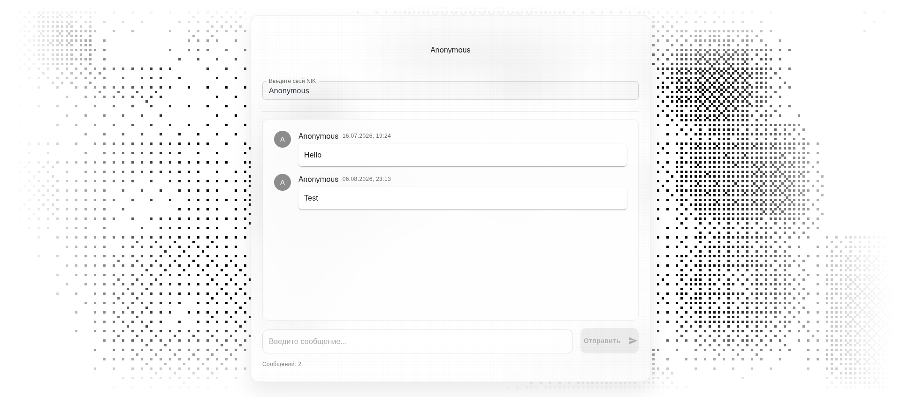

# nikto
Online chat for communicating with users

## Stack
Backend: Django, Django REST Framework  
Frontend: React(ts), MUI  
Realtime: Django Channels (ASGI), Redis channel layer  
Database: PostgreSQL  
Infrastructure: Docker, docker-compose, daphne  


## Local setup
```bash
git clone <repo>
cd nikto
cp .env.example .env
docker-compose up --build
docker-compose exec backend python manage.py migrate
```

### Next move: open http://localhost:3000/

## Photos
